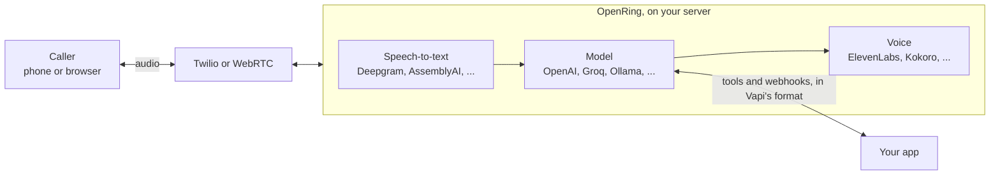

<div align="center">


# OpenRing

**Self-hosted voice AI agents with a Vapi-compatible API. No platform fee.**

[](https://github.com/elifalanrocha/openring/actions/workflows/ci.yml)
[](https://www.npmjs.com/package/openring)
[](https://pypi.org/project/openring/)
[](https://pypi.org/project/openring/)
[](LICENSE)

[](#-quick-start)
[](#-moving-from-vapi)

[Quick start](#-quick-start) · [How it works](#-how-it-works) · [Compare](#-how-it-compares) · [API guide](#-api-guide) · [Providers](#-providers) · [Roadmap](ROADMAP.md) · [Português](README.pt-BR.md)

</div>

Hosted voice platforms charge a fee for every minute of every call, on top of what you already pay for
speech-to-text, the model, the voice and the phone line. OpenRing does the same job on your own computer
or server, with your own provider keys, and speaks the same JSON as Vapi.

- 💸 **No platform fee, ever.** You pay Deepgram, OpenAI, Twilio or whoever you pick, directly, at their price.
- 🔁 **Vapi-compatible.** Same assistant JSON, provider names, tool calls and webhooks: a Vapi client moves
  over by changing its base URL, and **Import** copies an account in one click.
- 🖥️ **Yours.** Keys, calls and transcripts stay on your machine. No telemetry.
- 🆓 **Free to try.** A free local voice (Kokoro) is built in, so your first test call costs nothing.

## ⚡ Quick start

You need [Node.js](https://nodejs.org) 18 or later. Everything else, Python included, installs itself:

```bash
npx openring
```

The dashboard opens at http://localhost:8000. From there:

1. **Choose a password.** The first visit asks for one (only from this computer).
2. **Connect providers** on the **Providers** page: Deepgram for speech (new accounts get US$200 of credit)
   and a model, for example Groq's free tier or one-click sign-in with OpenRouter. Each key is checked with
   the provider before it's saved.
3. **Create an assistant** on **Assistants**: a greeting, instructions, a model and a voice.
4. **Talk to it.** Press **Test** and speak into your microphone. No phone number needed.
5. **Give it a number** when you're ready: see [Phone calls](#phone-calls).

Settings live in `~/.openring/.env`, created on the first run with a generated API key for apps that call
the API (it's under **Settings**). The free Kokoro voice downloads itself on the first start (about 120 MB).

## 🧭 How it works



Each call runs a [Pipecat](https://github.com/pipecat-ai/pipecat) pipeline: the caller's speech becomes
text, the model answers (and can call your tools), and the voice speaks the answer back. Every turn's
latency is recorded, step by step, and shown in the dashboard.

## 📊 How it compares

|  | OpenRing | Vapi | Retell | Dograh |
|---|---|---|---|---|
| Source code | ✅ Open (MIT) | ❌ Closed | ❌ Closed | ✅ Open core (BSD-2) |
| Platform fee | ✅ None | US$0.05/min | Per-minute pricing | None self-hosted, US$0.01/min in its cloud |
| Vapi-compatible API | ✅ | (it's Vapi) | ❌ | ❌ |
| Run it yourself | ✅ `npx openring`, no Docker needed (Docker works too) | Sign up for their cloud | Sign up for their cloud | ✅ With Docker |

On every platform you also pay for speech-to-text, the model, the voice and the phone line. Prices are
from each company's public pricing page in October 2026; check them before you decide. OpenRing isn't
affiliated with any of them.

## ✨ What works today

| Works today | Next |
|---|---|
| Browser test calls from the dashboard (WebRTC) | Automatic provider fallback and cost routing |
| Phone calls in and out through Twilio (**beta**: tell us how it goes) | Outbound calls through Telnyx; Plivo |
| Incoming calls through Telnyx (**beta**, see [Telnyx](#telnyx-beta)) | |
| Vapi-style `/assistant`, `/phone-number`, `/call` and `/tool` APIs | Cost per call in the dashboard |
| Vapi tools: `function`, `endCall`, `transferCall` | Outbound campaigns from a list |
| Vapi webhooks: `status-update`, `conversation-update`, `end-of-call-report`, `assistant-request` | Calls over WhatsApp |
| Import assistants, tools and numbers from a Vapi account | |
| 16 models, 6 speech-to-text and 9 voice providers, with Vapi's names | |
| Per-turn latency, call history with transcripts, light and dark themes | |

The full plan is in the [roadmap](ROADMAP.md).

## 🔁 Moving from Vapi

Copy every assistant, tool and Twilio number of an account in one request, or press **Import** on the
Assistants page. The key is used once and never stored; importing again updates what came in before.

```bash
curl -X POST http://localhost:8000/import \
  -H "Authorization: Bearer $OPENRING_API_KEY" -H "Content-Type: application/json" \
  -d '{"baseUrl": "https://api.vapi.ai", "apiKey": "YOUR_VAPI_PRIVATE_KEY"}'
```

The answer lists each assistant with anything that keeps it from taking calls here yet (for example a
provider OpenRing doesn't support yet). Documents keep their full JSON, so nothing is lost. Then point your
client's base URL at your server, and each imported Twilio number's voice webhook at
`$PUBLIC_URL/twilio/voice`.

## 📖 API guide

Every request takes `Authorization: Bearer $OPENRING_API_KEY`.

### Assistants

Same shape as Vapi:

```bash
curl -X POST http://localhost:8000/assistant \
  -H "Authorization: Bearer $OPENRING_API_KEY" -H "Content-Type: application/json" \
  -d '{
    "name": "Front desk",
    "firstMessage": "Hi! How can I help you today?",
    "model": {"provider": "openai", "model": "gpt-4.1-mini",
              "messages": [{"role": "system", "content": "You are a friendly receptionist."}]},
    "voice": {"provider": "11labs", "voiceId": "YOUR_VOICE_ID"},
    "transcriber": {"provider": "deepgram", "model": "nova-3", "language": "en"}
  }'
```

### Phone calls

Twilio has to reach your server, so it needs a public https URL. On your own computer, start a tunnel
(`cloudflared tunnel --url http://localhost:8000`), put its URL in `PUBLIC_URL` in `~/.openring/.env` and
restart. Then attach your Twilio number and point its **Voice webhook** (HTTP POST) at
`$PUBLIC_URL/twilio/voice`:

```bash
curl -X POST http://localhost:8000/phone-number \
  -H "Authorization: Bearer $OPENRING_API_KEY" -H "Content-Type: application/json" \
  -d '{"number": "+15551234567", "assistantId": "ASSISTANT_ID"}'
```

Call the number. Transcripts are at `GET /call` and on the **Calls** page.

To have the assistant call someone, send the same body as Vapi's `POST /call` (or use **Call a phone** in
the dashboard). Only call people who expect it: automated calls are regulated (the TCPA in the US, Anatel's
rules in Brazil). A Twilio trial account can only call numbers verified in its console.

```bash
curl -X POST http://localhost:8000/call \
  -H "Authorization: Bearer $OPENRING_API_KEY" -H "Content-Type: application/json" \
  -d '{"phoneNumberId": "PHONE_NUMBER_ID", "customer": {"number": "+5511912345678"}}'
```

### Tools

Tools use Vapi's format, so a server written for Vapi works unchanged. Put them in `model.tools`, or save
them once with `POST /tool` and list their ids in `model.toolIds`:

```json
"model": {
  "provider": "groq", "model": "openai/gpt-oss-20b",
  "tools": [
    {"type": "function",
     "function": {"name": "book_appointment", "description": "Book a cleaning",
                  "parameters": {"type": "object", "properties": {"day": {"type": "string"}}, "required": ["day"]}},
     "server": {"url": "https://your-app.com/tools"},
     "messages": [{"type": "request-start", "content": "One moment, let me check."}]},
    {"type": "endCall"},
    {"type": "transferCall", "destinations": [{"type": "number", "number": "+15551230000",
      "description": "front desk", "message": "Transferring you now."}]}
  ]
}
```

When the model calls `book_appointment`, OpenRing POSTs `{"message": {"type": "tool-calls", "toolCallList":
[...], "call": {...}}}` to the tool's `server.url` (or the assistant's) and reads back
`{"results": [{"toolCallId": "...", "result": "..."}]}`. `server.headers`, `server.secret`
(sent as `X-Vapi-Secret`), `server.timeoutSeconds`, `async` and the `request-start` / `request-failed`
messages work as on Vapi. `endCall` hangs up after the goodbye; `transferCall` moves a phone call to the
chosen number (Twilio) once the assistant stops talking. Tool calls and results show up in the call's
transcript.

### Server messages

Your assistant's `server.url` gets Vapi's messages in Vapi's shape (`{"message": {"type": ..., "call": {...}}}`),
with `server.headers` and `server.secret` (as `X-Vapi-Secret`):

- `status-update` when the call starts (`in-progress`), is transferred (`forwarding`) and ends (`ended`, with
  `endedReason`);
- `conversation-update` after each answer, with the transcript so far;
- `end-of-call-report` with the transcript and per-turn latency.

Pick which ones with `serverMessages`, as on Vapi. A phone number without an assistant but with its own
`server.url` asks it on each incoming call (`assistant-request`) and uses the `assistantId` or the transient
`assistant` it answers. `POST /call` also takes a transient `assistant` instead of an `assistantId`.

### Telnyx (beta)

Incoming calls through Telnyx are new and not yet confirmed on a real Telnyx call. In the Telnyx portal,
create a **TeXML Application** whose voice URL is `$PUBLIC_URL/telnyx/voice` (HTTP POST) and assign your
number to it. Add the number in OpenRing with `"provider": "telnyx"`, and set `TELNYX_API_KEY` and
`TELNYX_PUBLIC_KEY` (Keys & Credentials > Public Key), or connect Telnyx from the Providers page. Every
webhook is checked against that public key. Outbound calls and transfers go through Twilio for now.

## 🆓 The free stack

| Layer | Free option |
|---|---|
| Speech-to-text | Deepgram: US$200 credit for new accounts |
| Model | `"provider": "groq"` (free tier), `"provider": "omniroute"` (free local gateway to 150+ free providers) or `"provider": "ollama"` (local) |
| Voice | `"provider": "kokoro"`: runs on your CPU, no key |
| Phone line | A Twilio trial account, for testing |

## 🔌 Providers

Provider names are Vapi's, so an assistant JSON moves between the two unchanged. Connect each one from the
dashboard's **Providers** page, or put its key in `~/.openring/.env`.

| Layer | `provider` values | Key |
|---|---|---|
| Model | `openai`, `anthropic`, `google` (Gemini), `groq`, `openrouter`, `deepseek` / `deep-seek`, `xai`, `cerebras`, `together-ai`, `deepinfra`, `perplexity-ai`, `mistral`, `fireworks` | `OPENAI_API_KEY`, `ANTHROPIC_API_KEY`, `GOOGLE_API_KEY`, `GROQ_API_KEY`, ... (the provider's name) |
| Model, local | `ollama`, `omniroute`, or `custom-llm` with `model.url` (any OpenAI-compatible endpoint) | none |
| Speech-to-text | `deepgram`, `assembly-ai`, `gladia`, `soniox`, `cartesia`, `11labs` | `DEEPGRAM_API_KEY`, `ASSEMBLYAI_API_KEY`, `GLADIA_API_KEY`, `SONIOX_API_KEY`, `CARTESIA_API_KEY`, `ELEVENLABS_API_KEY` |
| Voice | `11labs` / `elevenlabs`, `cartesia`, `deepgram` (Aura), `openai`, `rime-ai`, `neuphonic`, `smallest-ai`, `inworld` | the provider's key (`RIME_API_KEY`, `NEUPHONIC_API_KEY`, `SMALLEST_API_KEY`, `INWORLD_API_KEY`, ...) |
| Voice, local | `kokoro` (free, runs on CPU) | none |

Use `"language": "multi"` on Deepgram for calls in several languages. With a Deepgram key you already have a
fast cloud voice: `{"provider": "deepgram", "voiceId": "thalia"}`.

Requests to OpenRouter carry OpenRing's name, so OpenRouter can list it among the apps that use it;
`OPENRING_ATTRIBUTION=false` leaves that out.

## 🐳 Docker

```bash
cp .env.example .env          # fill in your keys and OPENRING_PASSWORD
docker compose up --build     # dashboard and API on http://localhost:8000
```

On a server, set `PUBLIC_URL` to its https address so Twilio can reach it.

## 🧱 Principles

OpenRing never charges per minute, keeps your keys and data on your machine, stays compatible with Vapi
clients, runs with one command and says plainly what works and what doesn't. The whole list, and how we
decide what to build, is in [PRINCIPLES.md](PRINCIPLES.md).

## 🤝 Contributing

```bash
git clone https://github.com/elifalanrocha/openring && cd openring
pip install -e ".[dev,kokoro]"
pytest                 # about 20 s, no paid services needed
python -m openring
```

Small pull requests get merged fastest. Start with [CONTRIBUTING.md](CONTRIBUTING.md) and the
[good first issues](https://github.com/elifalanrocha/openring/labels/good%20first%20issue); see
[CHANGELOG.md](CHANGELOG.md) for what shipped.

## 🔒 Security

Set `OPENRING_API_KEY` before exposing the server. The dashboard has its own password: the first one can
only be chosen from the server's own computer (`http://localhost`) or with `OPENRING_PASSWORD`, so a stranger
who finds your tunnel URL cannot claim it first. Sessions are `HttpOnly`, `SameSite=Strict` cookies, and
repeated wrong passwords are slowed down. Forgot it? `openring --reset-password`. Incoming calls need
`TWILIO_AUTH_TOKEN`: every Twilio webhook is checked against its `X-Twilio-Signature`, and calls are refused
while the token is missing (`VALIDATE_TWILIO_SIGNATURE=false` turns the check off, for local tests only).
Each call accepts a single media stream, so a replayed or second connection is dropped. Found a
vulnerability? Please report it privately: see [SECURITY.md](SECURITY.md).

## ⭐ Star history

[](https://star-history.com/#elifalanrocha/openring&Date)

## 📄 License

MIT. Not affiliated with Vapi, Retell, Dograh or Twilio. OpenRing builds on
[Pipecat](https://github.com/pipecat-ai/pipecat) and other open-source projects, credited in
[THIRD_PARTY.md](THIRD_PARTY.md).
