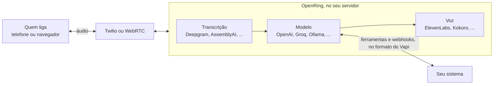

<div align="center">


# OpenRing

**Agentes de voz com IA no seu servidor, com API compatível com o Vapi. Sem taxa de plataforma.**

[](https://github.com/elifalanrocha/openring/actions/workflows/ci.yml)
[](https://www.npmjs.com/package/openring)
[](https://pypi.org/project/openring/)
[](LICENSE)

[](#-começo-rápido)
[](#-migrar-do-vapi)

[Começo rápido](#-começo-rápido) · [Como funciona](#-como-funciona) · [Comparação](#-comparação) · [Provedores](#-provedores) · [Roadmap](ROADMAP.md) · [English](README.md)

</div>

As plataformas de voz cobram uma taxa por cada minuto de cada ligação, em cima do que você já paga de
transcrição, modelo, voz e linha telefônica. O OpenRing faz o mesmo trabalho no seu computador ou servidor,
com as suas chaves, e fala o mesmo JSON do Vapi.

- 💸 **Sem taxa de plataforma, nunca.** Você paga Deepgram, OpenAI, Twilio ou quem escolher, direto, pelo preço deles.
- 🔁 **Compatível com o Vapi.** Mesmo JSON de assistente, mesmos nomes de provedor, ferramentas e webhooks:
  um cliente do Vapi migra trocando a URL base, e o **Import** copia uma conta com um clique.
- 🖥️ **Seu.** Chaves, ligações e transcrições ficam na sua máquina. Sem telemetria.
- 🆓 **Grátis para testar.** Vem com uma voz local grátis (Kokoro): a primeira ligação de teste não custa nada.

## ⚡ Começo rápido

Basta ter o [Node.js](https://nodejs.org) 18 ou mais novo. O resto, inclusive o Python, se instala sozinho:

```bash
npx openring
```

O painel abre em http://localhost:8000. A partir dele:

1. **Crie uma senha.** O primeiro acesso pede uma (só deste computador).
2. **Conecte os provedores** na página **Providers**: Deepgram para a fala (contas novas ganham US$ 200 de
   crédito) e um modelo, por exemplo o plano grátis do Groq ou o login de um clique do OpenRouter. Cada chave
   é conferida com o provedor antes de ser salva.
3. **Crie um assistente** em **Assistants**: saudação, instruções, modelo e voz.
4. **Converse com ele.** Clique em **Test** e fale no microfone. Não precisa de número.
5. **Dê um número a ele** quando quiser: veja [Ligações por telefone](#ligações-por-telefone).

As configurações ficam em `~/.openring/.env`, criado na primeira execução com uma chave de API gerada para os
apps que chamam a API (ela aparece em **Settings**). A voz grátis Kokoro se baixa sozinha na primeira
execução (cerca de 120 MB). Esqueceu a senha? `openring --reset-password`.

## 🧭 Como funciona



Cada ligação roda um pipeline do [Pipecat](https://github.com/pipecat-ai/pipecat): a fala vira texto, o
modelo responde (e pode chamar suas ferramentas) e a voz fala a resposta. A latência de cada turno é medida,
etapa por etapa, e aparece no painel.

## 📊 Comparação

|  | OpenRing | Vapi | Retell | Dograh |
|---|---|---|---|---|
| Código | ✅ Aberto (MIT) | ❌ Fechado | ❌ Fechado | ✅ Open core (BSD-2) |
| Taxa de plataforma | ✅ Nenhuma | US$ 0,05/min | Preço por minuto | Nenhuma no self-hosted, US$ 0,01/min na nuvem dele |
| API compatível com o Vapi | ✅ | (é o Vapi) | ❌ | ❌ |
| Rodar no seu servidor | ✅ `npx openring`, sem precisar de Docker (Docker também funciona) | Cadastro na nuvem deles | Cadastro na nuvem deles | ✅ Com Docker |

Em todas você também paga transcrição, modelo, voz e linha telefônica. Preços das páginas públicas de cada
empresa em outubro de 2026; confira antes de decidir. O OpenRing não tem vínculo com nenhuma delas.

## ✨ O que já funciona

| Já funciona | Próximos passos |
|---|---|
| Teste no navegador pelo painel (WebRTC) | Roteamento por custo |
| Rotas de modelo: modelos em ordem, compartilhados entre assistentes; o próximo assume quando um falha ou fica lento (**beta**) | |
| Stack 100% local e grátis: Whisper, Ollama e Kokoro, com um clique no editor | |
| Provedor reserva no formato do Vapi, inclusive de outro provedor (**beta**) | |
| Quem liga em qualquer idioma: o assistente responde no idioma dele (`"language": "multi"`) | |
| Ligações recebidas e feitas pelo Twilio (**beta**: conte como foi) | Ligações de saída pela Telnyx e pelo Genesys; Plivo |
| Campanhas: um assistente liga para uma lista ou CSV, algumas ligações por vez, chamando cada pessoa pelo nome (**beta**) | |
| Ligações recebidas pela Telnyx (**beta**) | |
| Ligações do Genesys Cloud pelo Audio Connector, dentro dos seus fluxos do Architect (**beta**) | |
| APIs `/assistant`, `/phone-number`, `/call`, `/campaign` e `/tool` no formato do Vapi | Custo por ligação em dólares |
| Ferramentas do Vapi: `function`, `endCall`, `transferCall` | |
| Webhooks do Vapi: `status-update`, `conversation-update`, `end-of-call-report`, `assistant-request` | Ligações pelo WhatsApp |
| Importação de assistentes, ferramentas e números de uma conta do Vapi | |
| 16 modelos, 6 transcrições e 9 vozes, com os nomes do Vapi | |
| Latência por turno, tempo até a primeira palavra, tokens e caracteres de voz por ligação, com farol | |
| Crédito restante no OpenRouter, Deepgram, ElevenLabs, Twilio e Telnyx, na página Providers | |
| Histórico com transcrição, tema claro e escuro | |

## 🔁 Migrar do Vapi

Copie todos os assistentes, ferramentas e números do Twilio de uma conta numa requisição só (ou clique em
**Import** na página Assistants). A chave é usada uma vez e não fica salva; importar de novo atualiza o que
veio antes.

```bash
curl -X POST http://localhost:8000/import \
  -H "Authorization: Bearer $OPENRING_API_KEY" -H "Content-Type: application/json" \
  -d '{"baseUrl": "https://api.vapi.ai", "apiKey": "SUA_CHAVE_PRIVADA_DO_VAPI"}'
```

A resposta lista cada assistente com o que ainda o impede de atender aqui (por exemplo, um provedor que o
OpenRing ainda não suporta). Depois, aponte a URL base do seu cliente para o seu servidor e o voice webhook
de cada número do Twilio importado para `$PUBLIC_URL/twilio/voice`.

## 📖 Guia da API

Toda requisição leva `Authorization: Bearer $OPENRING_API_KEY`. Os exemplos completos (ferramentas, mensagens
para o servidor, ligações feitas) estão no [guia em inglês](README.md#-api-guide).

Crie um assistente em português:

```bash
curl -X POST http://localhost:8000/assistant \
  -H "Authorization: Bearer $OPENRING_API_KEY" -H "Content-Type: application/json" \
  -d '{
    "name": "Recepção",
    "firstMessage": "Olá! Como posso ajudar?",
    "model": {"provider": "openai", "model": "gpt-4.1-mini",
              "messages": [{"role": "system", "content": "Você é uma recepcionista simpática. Responda em português."}]},
    "voice": {"provider": "11labs", "voiceId": "SEU_VOICE_ID"},
    "transcriber": {"provider": "deepgram", "model": "nova-3", "language": "pt-BR"}
  }'
```

### Provedor reserva (beta)

Mesmos campos do Vapi (`transcriber.fallbackPlan.transcribers`, `model.fallbackModels`,
`voice.fallbackPlan.voices`). Se um provedor falha no meio da ligação de um jeito que tentar de novo não
resolve (chave recusada, crédito acabado, provedor fora do ar), o próximo da lista assume até o fim. Diferente
do Vapi, o modelo reserva pode ser de outro provedor: `"fallbackModels": [{"provider": "openai", "model":
"gpt-4.1-mini"}]`. Quando o modelo troca, o novo responde a última fala de quem ligou. Exemplo completo no
[README em inglês](README.md#provider-fallback-beta).

### Rotas de modelo (beta)

Uma rota é uma lista de modelos em ordem, salva uma vez e usada por vários assistentes, como os combos do
OmniRoute. Crie na página **Model routes** (ou `POST /model-route`) e escolha no editor do assistente. A ligação
começa no primeiro modelo; o próximo assume quando um falha (chave recusada, crédito acabado, limite, fora do ar)
ou, com `maxLatencyMs`, quando demora mais que isso para começar a responder: a requisição lenta é cancelada e
o próximo responde a mesma fala. O modelo que falhou ou ficou lento descansa por `cooldownMinutes`, e as
próximas ligações já começam no seguinte até ele voltar. Exemplo no
[README em inglês](README.md#model-routes-beta).

### Ligações por telefone

O Twilio precisa alcançar o seu servidor por uma URL https pública. No seu computador, abra um túnel
(`cloudflared tunnel --url http://localhost:8000`), coloque a URL dele em `PUBLIC_URL` no
`~/.openring/.env` e reinicie. Depois cadastre o número do Twilio e aponte o **Voice webhook** (HTTP POST)
dele para `$PUBLIC_URL/twilio/voice`:

```bash
curl -X POST http://localhost:8000/phone-number \
  -H "Authorization: Bearer $OPENRING_API_KEY" -H "Content-Type: application/json" \
  -d '{"number": "+15551234567", "assistantId": "ID_DO_ASSISTENTE"}'
```

Ligue para o número. As transcrições ficam em `GET /call` e na página **Calls**. Para o assistente ligar
para alguém, use o mesmo corpo do `POST /call` do Vapi (ou **Call a phone** no painel). Ligue só para quem
espera a ligação: ligações automáticas são reguladas (as regras da Anatel no Brasil, a TCPA nos EUA).

**Telnyx (beta, ainda não confirmada numa ligação real):** no portal da Telnyx, crie uma **TeXML Application**
com a voice URL `$PUBLIC_URL/telnyx/voice` (HTTP POST) e associe o número a ela. Cadastre o número no OpenRing
com `"provider": "telnyx"` e defina `TELNYX_API_KEY` e `TELNYX_PUBLIC_KEY` (Keys & Credentials > Public Key),
ou conecte a Telnyx pela página Providers. Ligações de saída e transferências continuam pelo Twilio.

**Genesys Cloud (beta, ainda não confirmado numa ligação real):** o assistente atende dentro dos fluxos do
Architect, pelo **Audio Connector** do Genesys. Na página Providers, conecte **Genesys Cloud** (o botão
**Generate** cria a API key e o client secret; copie os dois antes de salvar). No Genesys, crie uma integração
Audio Connector com a URI `wss://SEU_HOST_PUBLICO/ws/genesys` (aparece na página Phone numbers) e essas duas
credenciais. No Architect, a ação **Call Audio Connector** escolhe o assistente pela variável de entrada
`assistantId`, ou cadastre o número discado no OpenRing com `"provider": "genesys"`. As outras variáveis de
entrada preenchem as `{{variáveis}}` do assistente. Na saída, `action` vale `finished` ou `transfer` (com o
número em `transferTo`), para o fluxo rotear a ligação. Conexão sem a API key e a assinatura do Genesys é
recusada.

### Campanhas (beta)

Um assistente liga para uma lista de pessoas, algumas por vez, com o mesmo corpo do `POST /campaign` do Vapi.
Cada pessoa recebe uma ligação de saída comum, com o `campaignId`, então transcrição e webhooks funcionam como
em qualquer ligação. No painel, **Campaigns > New campaign** aceita uma lista colada ou um CSV; as outras
colunas do CSV viram variáveis.

```bash
curl -X POST http://localhost:8000/campaign \
  -H "Authorization: Bearer $OPENRING_API_KEY" -H "Content-Type: application/json" \
  -d '{"name": "Lembrete de consulta", "phoneNumberId": "ID_DO_NUMERO", "assistantId": "ID_DO_ASSISTENTE",
       "maxConcurrency": 3,
       "schedulePlan": {"earliestAt": "2026-11-03T12:00:00Z", "latestAt": "2026-11-03T20:00:00Z"},
       "customers": [{"number": "+5511912345678", "name": "Maria",
                      "assistantOverrides": {"variableValues": {"horario": "15h"}}}]}'
```

A primeira mensagem e as instruções do assistente aceitam `{{customer.name}}`, `{{customer.number}}` e qualquer
chave de `variableValues`: `"firstMessage": "Oi {{customer.name}}, estou ligando para confirmar sua consulta
das {{horario}}."`. As ligações começam em `earliestAt` (ou na hora) e nenhuma nova começa depois de
`latestAt`. `PATCH /campaign/{id}` com `{"status": "cancelled"}` para a campanha. Se o servidor reiniciar, ele
retoma as campanhas sem ligar duas vezes para ninguém.

Ligue só para quem aceitou receber a ligação, no horário que a lei permite: ligações automáticas são
reguladas (as regras da Anatel no Brasil, a TCPA nos EUA). O painel pede essa confirmação em cada campanha.

## 🆓 Stack grátis

| Camada | Opção grátis |
|---|---|
| Transcrição | `"provider": "whisper"`: roda no seu computador, sem chave; ou o crédito de US$ 200 do Deepgram para contas novas |
| Modelo | `"provider": "ollama"` (local), `"provider": "groq"` (plano grátis) ou `"provider": "omniroute"` (gateway local grátis) |
| Voz | `"provider": "kokoro"`: roda na sua CPU, sem chave |
| Linha telefônica | Conta de teste (trial) do Twilio |

**100% local.** Whisper, Ollama e Kokoro juntos não custam nada por minuto, e o áudio da ligação não sai do
seu computador. No editor do assistente, clique em **Use the free local stack**, ou:

```json
"transcriber": {"provider": "whisper", "model": "base", "language": "pt-BR"},
"model": {"provider": "ollama", "model": "llama3.2"},
"voice": {"provider": "kokoro", "voiceId": "pf_dora"}
```

Antes, instale o [Ollama](https://ollama.com) e rode `ollama pull llama3.2`; a página Providers mostra se ele
está rodando e quais modelos tem. O Whisper baixa o modelo uma vez, quando um assistente o usa pela primeira
vez (`tiny` 75 MB, `base` 145 MB, `small` 480 MB; também `medium`, `large-v3` e `large-v3-turbo`). Usa a GPU
NVIDIA quando existe, senão a CPU: num notebook de 2018, uma frase de quatro segundos leva cerca de 0,6 s com
`tiny` e 1,2 s com `base`, e o dobro com `"language": "multi"`; escolha o idioma quando souber qual é.

## 🔌 Provedores

Os nomes são os mesmos do Vapi: o JSON de um assistente passa de um para o outro sem mudança. Conecte cada
um pela página **Providers** do painel, ou coloque a chave no `~/.openring/.env`.

- **Modelo:** `openai`, `anthropic`, `google` (Gemini), `groq`, `openrouter`, `deepseek`, `xai`, `cerebras`,
  `together-ai`, `deepinfra`, `perplexity-ai`, `mistral`, `fireworks`; locais e sem chave: `ollama`,
  `omniroute` ou `custom-llm` com `model.url`.
- **Transcrição:** `deepgram`, `assembly-ai`, `gladia`, `soniox`, `cartesia`, `11labs`; local e grátis: `whisper`.
- **Voz:** `11labs`, `cartesia`, `deepgram` (Aura), `openai`, `rime-ai`, `neuphonic`, `smallest-ai`,
  `inworld`; local e grátis: `kokoro`.

**Quem liga em qualquer idioma.** Com `"language": "multi"` (**Follow the caller** no painel), a transcrição
detecta o idioma, o OpenRing pede ao modelo que responda nele e troque quando quem liga trocar, e uma voz da
ElevenLabs ou da OpenAI lê o idioma que receber. As vozes do Kokoro e do Deepgram falam um idioma cada; o painel
avisa quando você escolhe uma delas. Quem já tem chave do Deepgram tem uma voz rápida na nuvem:
`{"provider": "deepgram", "voiceId": "thalia"}`.

## 🐳 Docker

```bash
cp .env.example .env          # preencha suas chaves e OPENRING_PASSWORD
docker compose up --build     # painel e API em http://localhost:8000
```

Num servidor, coloque em `PUBLIC_URL` o endereço https dele para o Twilio alcançá-lo.

## 🧱 Princípios

O OpenRing nunca cobra por minuto, mantém suas chaves e dados na sua máquina, continua compatível com
clientes do Vapi, roda com um comando e diz com clareza o que funciona e o que ainda não. A lista completa,
e como decidimos o que construir, está no [PRINCIPLES.md](PRINCIPLES.md) (em inglês).

## 🤝 Contribuir

```bash
git clone https://github.com/elifalanrocha/openring && cd openring
pip install -e ".[dev,kokoro,whisper]"
pytest                 # uns 20 s, sem precisar de serviço pago
python -m openring
```

Pull requests pequenos entram mais rápido. Comece pelo [CONTRIBUTING.md](CONTRIBUTING.md) e pelas
[good first issues](https://github.com/elifalanrocha/openring/labels/good%20first%20issue). Falhas de
segurança, por favor, de forma privada: veja o [SECURITY.md](SECURITY.md).

## 📄 Licença

MIT. Sem vínculo com Vapi, Retell, Dograh ou Twilio. O OpenRing usa o
[Pipecat](https://github.com/pipecat-ai/pipecat) e outros projetos open source, creditados em
[THIRD_PARTY.md](THIRD_PARTY.md).
